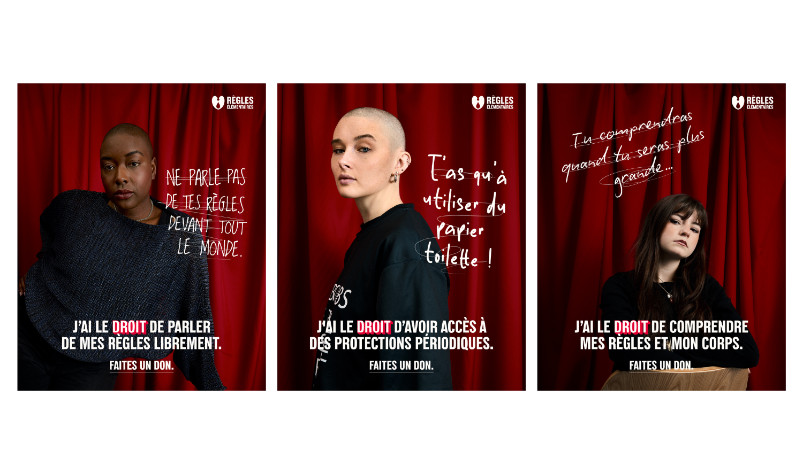

En cette fin d'année, avec **« Mes règles, mes droits »**, on veut faire entendre ce que ces phrases étouffent depuis trop longtemps : <https://justicemenstruelle.regleselementaires.com/>

## Quels droits, au juste ?

En 2015, quand Règles Élémentaires a commencé à parler de précarité menstruelle, le sujet était encore largement passé sous silence.

Depuis, on se bat pour que chacun·e puisse avoir accès à des protections périodiques. Et sur le terrain, dans nos ateliers comme dans nos échanges avec les associations, on retrouve d’autres questions très concrètes. À qui parler quand on a mal ? Comment savoir ce qu’il y a dans les protections qu’on utilise tous les mois ? Où trouver des réponses quand on découvre ses premières règles ?

C’est de ça qu’on parle quand on dit justice menstruelle. Du droit d’avoir accès à des protections, de savoir ce qu’elles contiennent, de comprendre son corps, de parler de ses règles librement et d’être écouté·e et soigné·e quand on a mal.

**Derrière chaque droit, une histoire**

Quand Nina a participé à l’un de nos ateliers d’éducation menstruelle, elle était en quatrième. L’atelier l’a marquée et, depuis, elle a gardé le lien avec l’association. Aujourd’hui, elle a 17 ans et elle est sur l’une de nos affiches. Ça nous touche de la retrouver là, quelques années après cette première rencontre en classe.

À ses côtés, il y a Enora Malagré, qui parle publiquement de son endométriose depuis des années, et Camille Aumont Carnel, militante féministe qui parle de règles même quand ça dérange. Surtout quand ça dérange.

Il y a aussi Mona Guba, rappeuse de talent en pleine ascension qui a dit oui quand on lui a proposé d’écrire un morceau sur les règles pour nos dix ans. Nadège Mongerard, qui parle sur scène et ailleurs de ce qu’on tait trop souvent, de la maternité à la santé mentale. Et Emma Razafimahefa, journaliste à Radio Nova et engagée pour les droits humains, qui relaie nos combats avec conviction.

On avait envie de faire cette campagne avec des femmes avec qui on avait déjà partagé un bout de chemin. Merci à toutes les six d’y avoir apporté leur voix et leur histoire.

Merci aussi à Lara Sanchez, qui a réalisé bénévolement les portraits, à Esther Balibar, qui l’a assistée à la lumière, et à Fanny Claudon, qui en signe la direction artistique.

Les droits ne se gagnent pas tout seuls.

Chaque don nous aide à distribuer des protections périodiques aux personnes qui en manquent, à animer des ateliers pour que les jeunes puissent poser leurs questions et à faire évoluer les pratiques et les lois. C’est comme ça qu’on fait avancer ces droits au quotidien.

[Rendez-vous ici https://justicemenstruelle.regleselementaires.com/ pour en savoir plus.](https://justicemenstruelle.regleselementaires.com/)

*Un don effectué au plus tard le 31 décembre 2026 ouvre droit à une réduction d’impôt sur le revenu de 66 % du montant versé, dans la limite de 20 % du revenu imposable. [service-public.gouv.fr](https://www.service-public.gouv.fr/particuliers/vosdroits/F426?utm_source=chatgpt.com)*

**Avoir ses règles ne devrait jamais priver de ses droits.**
